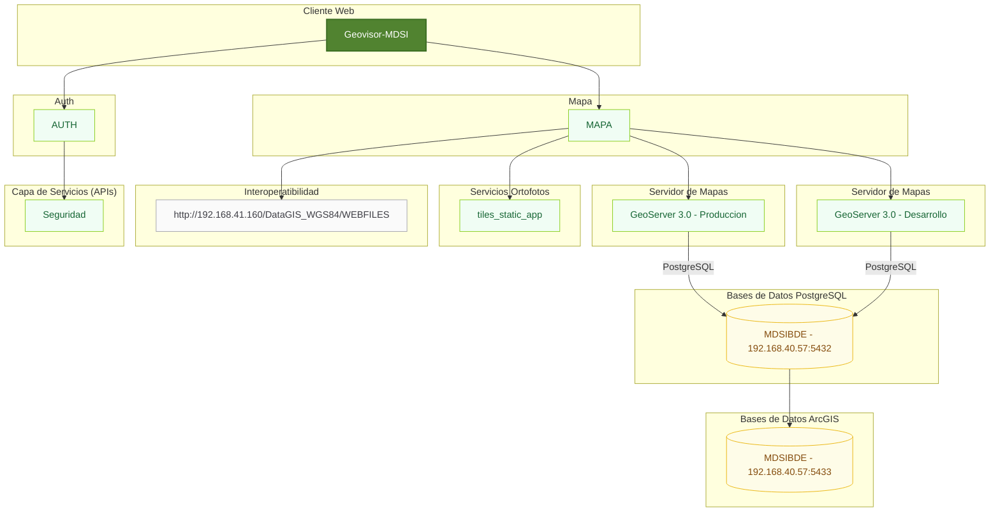

# Aplicativo Visor Geográfico del Visor Municipalidad de San Isidro

Aplicación frontend desarrollada con **Angular 20**.

---

## 🚀 Tecnologías

- Angular 20.0.0
- TypeScript
- RxJS
- Angular CLI
- HTML5 / TAILWIND
- Node.js ≥ 20

---

## 📦 Requisitos previos

- Node.js 20 o superior
- npm 9+ o yarn
- Angular CLI

```bash
npm install -g @angular/cli
```

---


## 🔐 Configuración de entornos

Los entornos se configuran en:

```
src/environments/
```

### Ambientes disponibles

| Archivo | Ambiente | Portal | API WSGEOVISOR | GeoServer |
|---|---|---|---|---|
| `environment.ts` | **Desarrollo** | `https://test.munisanisidro.gob.pe` | Ruta relativa (proxy local) | `http://192.168.40.58:8081/geoserver` (red interna) |
| `environment.qa.ts` | **QA** | `https://test.munisanisidro.gob.pe` | Ruta relativa (proxy inverso) | `http://192.168.40.58:8081/geoserver` (red interna) |
| `environment.prod.ts` | **Producción** | `https://geovisorcatastral.munisanisidro.gob.pe/` | `/api/WSGEOVISOR` (proxy inverso) | `https://geomapas.munisanisidro.gob.pe/geoserver` (público) |

Los tres archivos se generan con la fábrica `crearEnvironment()` de
`src/environments/environment.model.ts`, que centraliza toda la configuración
(GeoServer, DataGIS, TUSNE, APIs WSGEOVISOR, Observatorio Urbano, etc.).
Si algún servidor interno cambia por ambiente, se pasa como override:

```ts
export const environment = crearEnvironment({
  production: true,
  ambiente: 'Producción',
  portalUrl: 'https://geovisorcatastral.munisanisidro.gob.pe/',
  wsgeovisorUrl: '/api/WSGEOVISOR',
  // overrides opcionales de servidores internos:
  // geoserverUrl, ortofotoServerUrl, dataGisServerUrl, tusneServerUrl
});
```

### Comandos por ambiente

| Ambiente | Servir localmente | Generar build | Archivo de entorno | GeoServer incluido |
|---|---|---|---|---|
| **Desarrollo** | `npm start` | `ng build --configuration development` | `environment.ts` | `http://192.168.40.58:8081/geoserver` |
| **QA** | `npm run start:qa` | `npm run build:qa` | `environment.qa.ts` | `http://192.168.40.58:8081/geoserver` |
| **Producción** | `npm run start:prod` | `npm run build:prod` | `environment.prod.ts` | `https://geomapas.munisanisidro.gob.pe/geoserver` |

`npm run watch` también compila en modo desarrollo y vuelve a compilar al guardar.

> **Importante:** `npm run build` genera un build de **producción**; es equivalente
> a `npm run build:prod` (`ng build -c production`). No uses ese comando para
> generar el build de QA ni el de desarrollo. Para esos ambientes, usa los
> comandos explícitos de la tabla.

Los comandos `start` sirven la aplicación localmente; no generan el paquete final.
El build se genera en `dist/visor-mdsi/browser/`, listo para publicarse. Angular
selecciona el archivo de entorno mediante `fileReplacements` en `angular.json`:
`qa` reemplaza `environment.ts` por `environment.qa.ts` y `production` lo
reemplaza por `environment.prod.ts`. Por eso, las URLs de GeoServer incluidas
en el bundle corresponden al ambiente elegido al compilarlo.

---


## 📏 Estándares y buenas prácticas

- Arquitectura modular
- Lazy loading para módulos
- Tipado estricto habilitado
- ESLint configurado
- Angular Style Guide
- Separación clara de responsabilidades

---

## 🔀 Flujo de trabajo Git

- Rama principal: `main`
- Desarrollo y Producción: `main`
- Features: `feature/hu*`
- Fixes: `hotfix/*`


---

## 📦 Diagrama de componentes:


---

## 🌍 Links de las publicaciones:

[Local](http://localhost:4200/)

[Producción - URL](https://geovisorcatastral.munisanisidro.gob.pe)

[Producción - GeoServer](https://geomapas.munisanisidro.gob.pe)